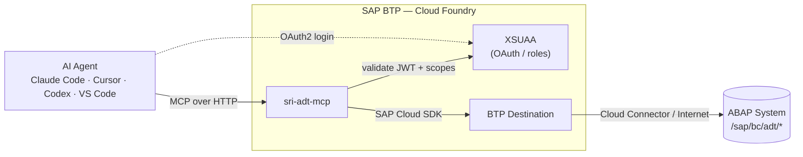
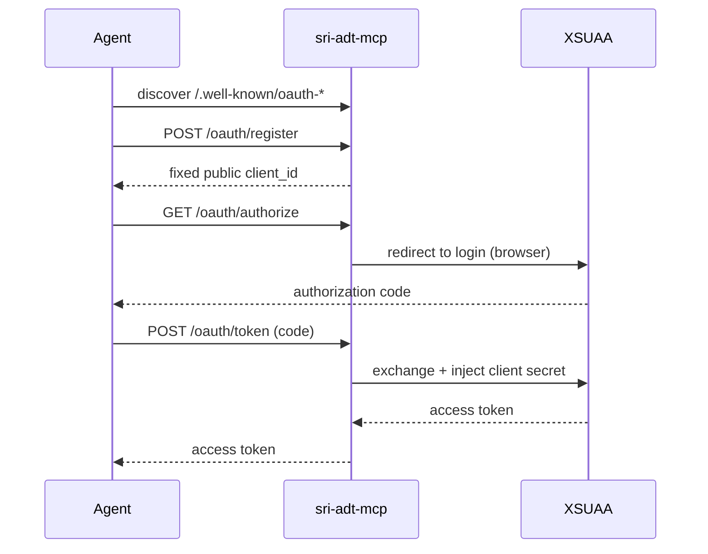

# sri-adt-mcp

> **Give your AI coding agent a full SAP ABAP developer seat** — search, read, edit, activate, test, transport and debug ABAP over the Model Context Protocol.

[](https://github.com/srijayant/sri-adt-mcp/actions/workflows/ci.yml)
[](LICENSE)
[](package.json)
[](https://modelcontextprotocol.io)
[](CONTRIBUTING.md)

sri-adt-mcp is an MCP server that gives AI coding agents (Claude Code, Cursor, Codex, VS Code Copilot, or any MCP client) the capabilities of **SAP ABAP Development Tools (ADT)**. Agents can search, read, create, edit, activate, check, test, transport and debug ABAP objects, the same as a developer in Eclipse.

It runs on **SAP BTP Cloud Foundry** and reaches the ABAP system through a **BTP destination** — so no backend credentials ever touch the developer's machine.

## Why sri-adt-mcp

- 🧠 **Any MCP client, one URL** — works with Claude Code, Cursor, Codex, VS Code Copilot, or anything that speaks MCP.
- 🔐 **Zero credentials on the dev machine** — browser OAuth login to BTP; backend credentials stay in the destination and never leave BTP.
- 🧰 **60+ tools spanning the whole ADT surface** — navigate, edit, activate, syntax-check, ATC, unit tests, transports, runtime, debugger, abapGit.
- 🏢 **Enterprise-ready controls** — role-gated read vs. write, package allowlists, global read-only mode, and multiple destinations from one deployment.
- 🚪 **No dead ends** — `adt_request` reaches any `/sap/bc/adt` endpoint your release supports, even without a dedicated tool.
- 🪪 **Per-developer identity, optional** — flip the destination to PrincipalPropagation and every call runs as the real developer, no code change.

> If this saves you from hand-wiring ADT calls, please ⭐ **star the repo** — it genuinely helps others find it.

## Architecture



- **No credentials on the developer's machine.** In the agent you add a URL and sign in with your BTP account in the browser. The agent handles and refreshes tokens.
- **Backend credentials live in the destination.** They never leave BTP.
- **Access is controlled by BTP role collections.** Users without write rights only see read-only tools.

## How identity works

1. **Access to the MCP server:** every request needs an XSUAA token for a signed-in user. Technical tokens (`client_credentials`) are rejected.
2. **Access to the ABAP system:** the destination decides which user ABAP sees.
   - With `BasicAuthentication`, all calls run as the **user configured in the destination**. That user owns locks, transports and inactive objects.
   - The signed-in user's JWT is always passed to the destination. So if you switch the destination to `PrincipalPropagation` (on-premise, via Cloud Connector) or an OAuth2 user-propagating type, calls run as each developer's own ABAP user, with no code change.

## Prerequisites

- A BTP subaccount with Cloud Foundry, and entitlements for `xsuaa` (application), `destination` (lite) and `connectivity` (lite).
- An ABAP system (S/4HANA, or ABAP Platform ≥ 7.5x) with the SICF service `/sap/bc/adt` active.
- For on-premise systems: SAP Cloud Connector, with a system mapping that allows the path `/sap/bc/adt` (with sub-paths).
- The ABAP user needs the usual developer authorizations: S_DEVELOP, S_ADT_RES, S_TCODE (SE80), and S_TRANSPRT/S_CTS_ADMI for transports.
- [MTA Build Tool](https://sap.github.io/cloud-mta-build-tool/) (`npm i -g mbt`) and the CF CLI with the MultiApps plugin.

## 1. Create the destination

In the BTP cockpit, go to **Connectivity → Destinations → New Destination**.

| Property | Value |
|---|---|
| Name | `ABAP_ADT` (or anything else; set `SRI_ADT_DESTINATION` to match) |
| Type | HTTP |
| URL | `http://<virtual-host>:<port>` (on-premise) or `https://<host>` (cloud) |
| Proxy Type | `OnPremise` (Cloud Connector) or `Internet` |
| Authentication | `BasicAuthentication` with the ABAP user and password |
| Additional property `sap-client` | e.g. `100` |

## 2. Deploy

```bash
git clone <this repo> && cd sri-adt-mcp
# Optional: edit mta.yaml properties (SRI_ADT_DESTINATION, SRI_ADT_READONLY, SRI_ADT_ALLOWED_PACKAGES)
cf login -a https://api.cf.<region>.hana.ondemand.com
npm run deploy          # mbt build && cf deploy
cf app sri-adt-mcp      # note the route
curl https://<route>/health
```

The MTA creates:
- the app;
- `sri-adt-mcp-xsuaa`, from [xs-security.json](xs-security.json);
- `sri-adt-mcp-destination`;
- `sri-adt-mcp-connectivity`.

## 3. Assign roles

In the BTP cockpit, go to **Security → Users** and assign:
- **`SRI_ADT_Developer`** for all tools;
- **`SRI_ADT_Viewer`** for read-only tools.

## 4. Connect your agent

Only the URL is needed. On first use the agent opens a browser to sign in with BTP.

**Claude Code** (`.mcp.json` in your project, or `claude mcp add --transport http sri-adt https://<route>/mcp`). Then run `/mcp` → *sri-adt* → *Authenticate*.
```json
{ "mcpServers": { "sri-adt": { "type": "http", "url": "https://<route>/mcp" } } }
```

**VS Code** (`.vscode/mcp.json`)
```json
{ "servers": { "sri-adt": { "type": "http", "url": "https://<route>/mcp" } } }
```

**Cursor** (`~/.cursor/mcp.json`)
```json
{ "mcpServers": { "sri-adt": { "url": "https://<route>/mcp" } } }
```

**Codex** (`~/.codex/config.toml`). Then run `codex mcp login sri-adt`.
```toml
[mcp_servers.sri-adt]
url = "https://<route>/mcp"
```

### How the OAuth login works



XSUAA doesn't support dynamic client registration, which MCP clients expect. So the app acts as a small authorization-server front end:
- It serves `/.well-known/oauth-protected-resource` and `/.well-known/oauth-authorization-server`.
- `/oauth/register` returns a fixed public client id.
- `/oauth/authorize` redirects to the XSUAA login page.
- `/oauth/token` passes token requests to XSUAA, adding the XSUAA client secret on the server side.

The agents' local callback URLs are allowed through `redirect-uris` in `xs-security.json`. If your client uses a different callback, add it there and run `cf update-service sri-adt-mcp-xsuaa -c xs-security.json`.

## Configuration

Set these as properties in `mta.yaml`, or with `cf set-env`.

| Variable | Purpose |
|---|---|
| `SRI_ADT_DESTINATION` | **Required.** Default destination name. |
| `SRI_ADT_DESTINATIONS` | Further destinations that callers may select with a tool's `destination` argument, comma-separated (e.g. `ABAP_DEV,ABAP_QAS`). Any other name is refused. |
| `SRI_ADT_READONLY` | `true` hides every tool that changes, runs, transports or debugs anything, for all users. |
| `SRI_ADT_ALLOWED_PACKAGES` | Packages that create, write and delete may touch, e.g. `Z*,$TMP`. |
| `SRI_ADT_TIMEOUT_MS` | Timeout per backend request (default 120000). |
| `SRI_ADT_MAX_OUTPUT` | Maximum characters returned per tool call (default 200000). |
| `SRI_ADT_PUBLIC_URL` | External base URL, if the app sits behind a custom domain or proxy. By default it is taken from the request headers. |

## Tools

Most tools that point at an object take either `type` + `name` or `uri`. Types: PROG, INCL, CLAS, INTF, FUGR, FUNC (+`group`), FUGR_INCL, DDLS, DCLS, DDLX, BDEF, SRVD, SRVB, TABL, STRU, TTYP, DTEL, DOMA, MSAG, DEVC, XSLT, ENHO, ENHS, DDLA, SAJC.

| Area | Tools |
|---|---|
| Universal | `adt_request` (any method/path/body under /sap/bc/adt, with CSRF handled), `adt_get`, `adt_discovery`, `adt_system_info`, `adt_reset_session` |
| Navigate | `search_objects`, `get_object_properties`, `get_object_structure`, `get_package_contents`, `where_used` (+snippets), `find_definition`, `get_type_hierarchy`, `list_object_versions`, `get_version_source` |
| Source / edit | `read_source`, `write_source` (lock → write → unlock → activate), `lock_object`, `unlock_object`, `delete_object`, `rename_symbol` |
| Create | `create_object` (programs, includes, classes, interfaces, function groups/modules, CDS, BDEF, SRVD, SRVB, tables, structures, DTEL, DOMA, MSAG, packages), `create_class_include`, `upsert_message` |
| Checks | `activate` (mass), `get_inactive_objects`, `syntax_check` (also on unsaved source), `pretty_print`, `code_completion`, `quickfix_proposals`, `apply_quickfix`, `abap_documentation` (F1) |
| Quality | `run_atc`, `get_atc_worklist`, `get_atc_customizing`, `run_unit_tests` (+coverage) |
| Transports | `list_transports`, `get_transport`, `get_transport_for_object`, `create_transport`, `release_transport`, `delete_transport`, `change_transport_owner`, `add_user_to_transport` |
| Runtime | `run_class` (IF_OO_ADT_CLASSRUN), `data_preview`, `run_sql`, `list_dumps`, `get_dump`, `list_traces`, `get_trace` |
| Debugger | `debugger_set_breakpoints`, `debugger_listen`, `debugger_attach`, `debugger_step`, `debugger_stack`, `debugger_variables` |
| Services / DDIC / enhancements | `get_service_binding`, `publish_service_binding`, `get_ddic_element`, `get_cds_annotation_definitions`, `get_enhancement`, `get_badi_implementations` |
| abapGit | `abapgit_list_repos`, `abapgit_link_repo`, `abapgit_pull`, `abapgit_stage`, `abapgit_push` |

For any ADT feature without a dedicated tool, use `adt_request`. `adt_discovery` shows what your backend release supports.

## Things to know

- **Sessions.** Each signed-in user gets their own ADT session (CSRF token and cookies), so lock → edit → unlock works across tool calls. Sessions expire after 30 minutes idle.
- **Debugger.** It works best-effort only, because it relies on long polling through the destination. Keep `debugger_listen` timeouts short.
- **Running reports.** ADT has no REST endpoint for running classic reports. Use `run_class` with IF_OO_ADT_CLASSRUN, or AUnit.
- **Safety.** Use `SRI_ADT_ALLOWED_PACKAGES` and `SRI_ADT_READONLY` for shared or production-like systems. Remember that with `BasicAuthentication` every user acts as the destination's user.

## Development

```bash
npm install
npm run build
npm test
```

## License

[MIT](LICENSE)
